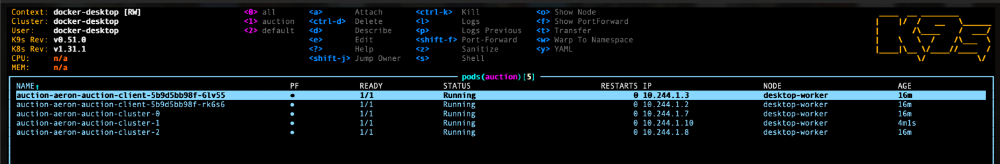

# Aeron Auction

See the [full design](https://gc-garcol.github.io/aeron-auction) for details.

## Kubernetes

[`infra/k8s/`](infra/k8s) has a Helm chart for the 3-node cluster and the client, with values for a local cluster and
scripts for local images and Vault secrets. See [readme.k8s.md](readme.k8s.md) to deploy it.

